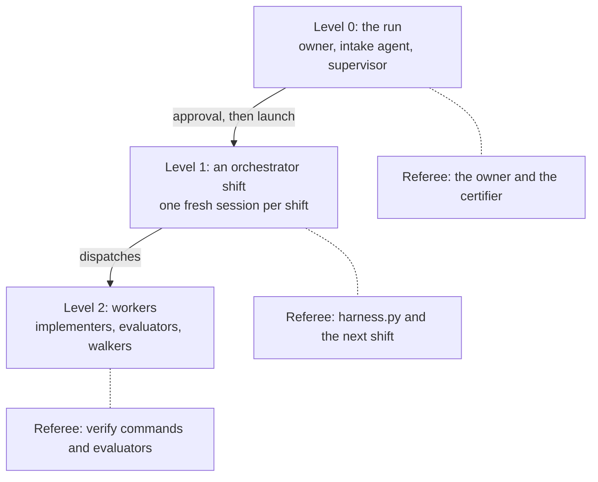
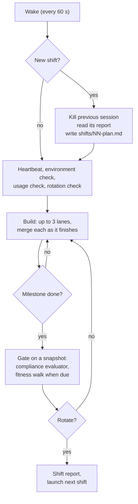

# The long-run harness architecture

## What it is

`long-run` is a Claude Code skill that turns a goal stated in conversation into work that runs unattended for hours or days, until an independent agent certifies it done. A **harness** is the loop and rules that keep an agent working toward a goal: what it reads at the start, what it may change, who checks its work, and when it stops.

The **owner** is the person who sets the goal, approves the run and makes the decisions no agent should make alone. The owner is present for the first part of the run and for the final review. Everything in between runs without them.

**When not to use it.** A goal that fits in about an hour needs a plan and one session. A goal that a dedicated, proven skill already handles goes to that skill.

The skill has six modes:

| Mode | Who runs it | What it does |
| --- | --- | --- |
| `new <goal>` | Owner and agent | Intake, foundation work, approval, launch |
| `supervise <RUN_DIR>` | The launching session | Watches the run, relays the owner |
| `shift <RUN_DIR>` | Orchestrator, unattended | One orchestrator shift |
| `status <RUN_DIR>` | Anyone | Summarises the run's state |
| `note <RUN_DIR> <text>` | Owner | Steers a live run, answers rulings |
| `resume <RUN_DIR>` | Anyone | Relaunches a stopped run |

## The three levels

The run nests three harnesses. Each level has its own unit of work, its own task list, and a referee that sits outside it. The orchestrator works in fresh context windows with a task list and fixed start and end points, the same as the builders, at a coarser grain.

Every level has the same eight properties:

| Property | Meaning |
| --- | --- |
| Unit | One bounded piece of work |
| Task list | Written to disk before starting |
| Start routine | Fixed reads, same order |
| End point | Writes an output file |
| State | Disk and git only |
| Referee | Something other than itself |
| Caps | Rounds, time, budget |
| Stall rule | Measured progress, a ladder |

| Level | Unit | Task list | End point | Referee |
| --- | --- | --- | --- | --- |
| 0: the run | The whole run | BRIEF, JOBS, INVENTORY, APPROVAL | CERTIFICATION.md | Owner, certifier |
| 1: a shift | One shift | `shifts/NN-plan.md` | `shifts/NN-report.md` | harness.py, next shift |
| 2: a worker | A batch, gate or walk | Its brief | Its output file | Verify, evaluators |

A worker's reply is a claim, so the orchestrator re-runs the worker's checks itself. A shift's report would also be a claim, so the script writes the facts in it.

## Level 0: intake, foundation and approval

Level 0 is the only attended part. Its goal is to ask every question only the owner can answer before the run starts.

### 1. Scale the intake

| Goal type | Questions |
| --- | --- |
| Rulebook plus a domain pack | None, brief only |
| Known domain | Up to 5 |
| Novel or ambiguous | Up to 12 |

A **domain pack** is a library of probes and edge cases for one kind of product, grown from earlier runs. Questions go one at a time, ranked by impact times uncertainty, each with the agent's recommended answer. The owner's words go into `BRIEF.md` verbatim.

### 2. Walk every input

The **interaction inventory** (`INVENTORY.md`) has one row per input of the product, not a sample: the field, the values it takes, the control a user sees, the predecessor's control, and the agent's default. Checks then target the control a person uses. An earlier run without this table passed 353 tests and shipped a single dropdown where the user needed to pick several values.

### 3. Sort the questions

The **builder check** is a fresh agent that reads the brief as the person who must build the result and lists every question it would need answered. The intake agent answers the minor ones itself as logged calls. The owner sees only the questions that need the owner, in one batch.

### 4. Classify the run

A **flat** run's "done" is checkable today. A **staged** run's "done" depends on answers the run must find on the way.

### 5. Foundation work

The intake agent then does the foundation work alone:

- **Research** into reference products and prior art (`research/NOTES.md`).
- **Readiness probes.** Each property is set with the build tool and read back with the fitness instrument (the tool a user would use, such as a browser). Anything no tool can perceive is raised now as a blind spot.
- **Spec and design**, with an edge-case matrix and mockups for anything user-facing.
- **Rubric** (`RUBRIC.md`): the pass criteria. Every criterion cites a user job or a do-not-regress item, never the existing implementation.
- **Plan** (`features.json`): one small feature per behaviour, each with a verify command the worker cannot argue with. A coverage evaluator checks the plan against JOBS and INVENTORY, at most 3 rounds.
- **AGENT-BRIEF.md**: the hard rules, secrets rules and banned commands, pasted verbatim into every dispatch.

### 6. The one-page approval

`APPROVAL.md` takes about 10 minutes to read: the jobs, the inventory, every default chosen, open questions, probe results and blind spots, the usage budget, the run shape, and when the first playtest should arrive. The owner does not read the rubric.

The usage budget is a ceiling that stops the run, never a pace. The run always goes as fast as the machine allows, and no step is slowed to fit the hours.

On "go", the script freezes JOBS, INVENTORY and RUBRIC, sets the run to RUNNING, installs the watchdog cron line, and launches shift 1 in a fresh session, with none of the intake conversation in its context.

### 7. The supervisor

The session that ran the intake does not end at launch. It becomes the run's **supervisor**, the one place the owner talks to the run:

- **It streams changes.** A read-only script polls the run every 60 seconds and prints one line per change: new commits, features passing or failing again, gates, walks, rotations, new rulings, a stuck dialog in the shift's session. Every 10 minutes it prints a short "still running" line. Silence between those lines means the run is fine.
- **It fixes harness faults**, such as a shift that keeps relaunching or a broken script, then relaunches. It never hand-edits the state file or a frozen file.
- **It relays the owner.** Rulings and steering given in its chat are written into the run's notes verbatim, where the next shift reads them.
- **It answers questions** about the run from the files on disk.

The supervisor never builds and never dispatches workers into the run. The shift owns the run's loop, and two orchestrators would race.

## Level 1: the orchestrator shift

The **orchestrator** is the agent that plans and dispatches. It does not build and it does not judge. It dispatches fresh subagents, runs the verify commands itself, records facts through `harness.py`, and keeps the run moving. It never asks a question in chat, because no one is watching the session.

A shift runs inside a `/loop` that re-enters the skill on every wake. Each turn ends with a 60-second wakeup.

### 1. Every wake

One `harness.py tick` call starts or continues the shift, records its heartbeat and context size, checks the environment and the usage budget, and says whether to rotate. A new shift first reads the previous shift's report, whose facts block the script wrote. Where the report's plans conflict with the facts, the facts win. If the previous shift crashed, committed work is credited before anything is planned, so no committed feature is built twice.

### 2. Building in lanes

The orchestrator's job is to keep every lane full. It groups the failing features of the current milestone into batches of 1 to 5 that touch different files, and opens a **lane** for each: a separate git worktree branched from the run's current commit. A fresh **implementer** builds each batch in its own lane, so implementers never share a git index or a half-written file.

| Limit | Value |
| --- | --- |
| Implementer lanes | Up to 3 |
| Subagents at once, unattended | Up to 4 |
| When memory is under 8 GB | Up to 2 |
| Verify commands in parallel | 4 |

When an implementer's report file exists, one `harness.py lane merge` call lands the lane. It merges the lane into the run worktree, runs `harness.py verify` on its features at the new commit, and reconciles the implementer's claims against the result. It also imports the implementer's hypotheses into an **attempts record**, so the next implementer does not repeat a refuted theory. A claim the script did not see goes into the next brief as a fact. A merge conflict sends the features back to the queue with a note naming the files, and they are rebatched away from the lane they collided with.

A change that touches everything, such as a rename, still runs as a single implementer in the run worktree, with no lanes open.

### 3. Gate

At the end of a milestone, every finished lane is merged, every feature is re-verified, and changed test files are flagged. A **compliance evaluator** then tries to prove the milestone not done. It works on a read-only **snapshot** of that commit, so lanes for the next milestone keep building and merging during the gate. The script reads the evaluator's verdict line from its file. Findings are labelled:

| Label | Becomes |
| --- | --- |
| DEFECT | Work |
| JOB-FAILURE | Work |
| POSSIBLE-FEATURE | A question for the owner |

A gate runs at most 3 rounds. After round 3 the evaluator writes PASS-WITH-RESIDUALS with the open findings as a punch list. Wrong results, hard-rule violations and job failures block without limit; polish gets 2 rounds.

### 4. Fitness walks

A **fitness walk** is a fresh agent that uses the product the way a person would, through the fitness instrument. It sees only the jobs, the scenarios, the inventory and the product, never the code or the rubric. Walks happen at the walking skeleton (the first build where a core job works end to end), at about 60% of features passing, and on the final build. A walk that falls at a gate runs beside the compliance evaluator, on its own snapshot, so nothing it leaves behind can affect a verify. Each walk produces a short PLAYTEST note for the owner. The run never waits for an answer; it continues on defaults and tags dependent work.

Where the goal has a quality bar, the 60% and final walks add a **blind comparison**: a judge sees shuffled screenshot pairs from the build and from a reference product and picks the better one. The tally informs the owner and never blocks.

### 5. Rotation

A shift ends at a gate boundary once context passes the soft threshold (350,000 tokens), or anywhere at the hard threshold (550,000 tokens). It writes the plans part of its report, the script writes the facts block, and `launch_shift.sh` starts the next shift in a new detached tmux session (a terminal session that keeps running with no window attached). The new shift kills the old session.

## Level 2: the workers

Every worker is a fresh subagent with a prompt file in `agents/`. Its dispatch is built by `harness.py brief`, which pastes AGENT-BRIEF.md and the relevant records. The orchestrator waits for the worker's output file to exist, not for its reply.

| Role | When | Output |
| --- | --- | --- |
| Researcher | Foundation | research/NOTES.md |
| Builder check | Intake | Sorted questions |
| Planner | Foundation | features.json |
| Coverage evaluator | Foundation | Plan verdict |
| Implementer | Each lane | iterations/NN-impl.md |
| Compliance evaluator | Each gate | gates/M-rN.md |
| Fitness evaluator | Three walks | fitness/N.md |
| A/B judge | Quality walks | evidence/ab/N/TALLY.md |
| Approach proposer | Stuck work | A new approach |
| Certifier | End of run | CERTIFICATION.md |

Every worker ends with one of four statuses: DONE, DONE_WITH_CONCERNS, BLOCKED or NEEDS_CONTEXT. The last two go back to the orchestrator.

## What harness.py owns

`harness.py` is a bookkeeping script. It never chooses work. It owns the facts the agents could otherwise misreport:

- **Only `harness.py verify` marks a feature passing.** Nobody hand-edits STATE.json.
- **It writes the facts block of every shift report**, so a shift cannot misreport what it did.
- **It reads verdicts from evaluator files**, not from the orchestrator's summary.
- **It prints a `NEXT:` line** where the next step is mechanical.

Every command prints one machine-readable first line and exits with a fixed code:

| Code | Meaning |
| --- | --- |
| 0 | OK |
| 3 | Refused, frozen or rule |
| 4 | Environment fault |
| 5 | Budget exceeded |
| 6 | Not ready or not passing |
| 7 | Usage paused |

**Who may change a check.** Any agent may tighten a check. Only the owner may loosen one, and a loosening needs the owner's words recorded in DECISIONS. Each tightening is a logged decision that re-freezes the changed file.

## When work gets stuck

The **stall ladder** gives every stuck feature a next step, in this order.

### 1. Retry with the attempts record

The retry gets which theories were tried and refuted, never the raw failure output. A model that sees its own failed output tends to repeat it.

### 2. Try a different method

If the spec names an oracle (a known-good implementation or reference output), use it to locate the fault.

### 3. Ask the approach proposer

A fresh agent reads the attempts record and recommends a new approach.

### 4. Defer

Only after rungs 1 to 3 failed. A core feature cannot be deferred without the owner's ruling, and nothing is deferred to protect a check.

### 5. Notify the owner

If every remaining feature waits on the owner, the run moves to a blocked state and the shift stops its loop. The watchdog resumes it within a minute of the owner answering a ruling or adding a note.

## Rulings and staged runs

A question for the owner becomes a **ruling** entry (`JR-NN` in the rulings file) with options, a recommendation, what it blocks, and a provisional default. Work built on a default carries `provisional: JR-NN`, so it can be reopened if the owner rules differently. The orchestrator's own decisions are **calls** (`D-NN` in DECISIONS.md).

A **staged run** is for a goal whose answers create the next questions. The planner writes only the next stage in full. A stage ends at the next ruling that blocks the critical path. Each stage states its expected sizes and counts up front as **tripwires**; when reality differs, the stage stops and opens a blocking ruling with a re-plan. The metric is owner-minutes per ruling, not agent hours.

## The guards

### Frozen files

JOBS.md, INVENTORY.md and RUBRIC.md are hashed and made read-only at approval, along with each feature's behaviour and verify command. Every gated command checks the hashes first and refuses on a mismatch. A tightening re-freezes through a logged decision.

### Banned commands

`guard_unattended.py` is a PreToolUse hook (it runs before every tool call) registered for the run's sessions. It denies, and names the safe alternative for:

- `git push`, `git reset --hard`, `git checkout --`, `git restore`, `git clean`, forced branch deletes
- recursive force deletes, `sudo`, `pkill`, `killall`, and killing any tmux session but this run's own
- any write under `~/.claude/` or `/tmp/`, to a frozen file, or to STATE.json
- anything mentioning usage credits or extra usage

It costs about 20 ms per call. An internal error allows the call and logs it, and every denial is logged with the full command.

### Usage ceiling

Each wake checks the 5-hour and 7-day usage windows. At 80% of either, the run goes to USAGE-PAUSED with a resume time set to that window's reset, and the shift ends. When the reset time had to be guessed, the run resumes as soon as usage reads under the ceiling. The run never uses extended usage credits.

### Watchdog

`watchdog.py` runs from cron every minute and calls no model. For each registered run:

| Condition | Action |
| --- | --- |
| Finished, paused, or in intake | Skip |
| Usage paused, window reset | Resume |
| Blocked, owner wrote | Resume |
| Approved, never launched | Launch now |
| No session, heartbeat over 2 min | Relaunch |
| Session, heartbeat over 3 min | Read the pane |
| Pane shows a prompt | Alert, never kill |
| Pane busy over 20 min | Alert hourly |
| Pane idle | Kill, relaunch |
| 3 relaunches in 6 hours | Pause, notify |

A busy pane includes a spinner and a shift waiting on its background agents; a long verify is normal for minutes at a time. Runs still in intake or foundation are skipped so no shift launches before approval.

## Timing

Every interval is about a minute.

| Timer | Value |
| --- | --- |
| Shift wake | 60 s |
| Supervisor poll | 60 s |
| Supervisor heartbeat | 10 min |
| Environment-fault retry | 60 s |
| Watchdog cron | 1 min |
| Stale heartbeat | 2 min |
| Hung session | 3 min |
| Busy-pane alert | 20 min |
| Usage unknown, after reset | 1 min |
| Relaunch cap | 3 per 6 h |
| Usage ceiling | 80% |
| Soft rotation | 350k tokens |
| Hard rotation | 550k tokens |

A stale heartbeat at 2 minutes is one missed 60-second wake plus margin. A blocked run does not wake to look for answers; the watchdog notices the owner's write instead.

## Certification

1. The final fitness walk runs at the last gate, beside the compliance evaluator, and every pass record must be at the final commit.
2. `harness.py certify-ready` refuses if anything fails, a PLAYTEST note is missing, or a DEFECT or JOB-FAILURE finding is still open. The check runs before a certifier is dispatched, so an unfinished run never costs a certification round.
3. The **certifier**, a fresh agent, reads the script's verify records, re-runs five at random, and writes CERTIFICATION.md.
4. The run stays certified-pending until the owner's final review, then it is finished.
5. The retrospective records which mechanisms helped. Each miss the owner caught becomes a probe in the domain pack, and each harness miss becomes a test fixture.
6. Scripts used twice move to the owning project, so nothing points into the run directory afterwards.

## The run directory

Each run has its own directory, which moves to the project that owns the work at close. Its product code lives in a separate git worktree, so other sessions working in the same repository never collide with its commits.

| File | Written by | Holds |
| --- | --- | --- |
| BRIEF.md | Owner | The goal, verbatim |
| JOBS.md | Frozen | User jobs |
| INVENTORY.md | Frozen | Every input |
| RUBRIC.md | Frozen | Pass criteria |
| features.json | Planner | Features, verifies |
| STATE.json | Script | Passing, state, timers |
| DECISIONS.md | Orchestrator | D-NN calls |
| Rulings file | Owner | JR-NN rulings |
| ORCHESTRATOR-NOTES.md | Owner | Steering notes |
| shifts/ | Both | Plans and reports |
| scratch/lanes/ | Script | Lane worktrees |
| iterations/, gates/, fitness/ | Workers | Output files |
| CERTIFICATION.md | Certifier | Final verdict |

## Testing the harness

The **toy run** is a three-feature command-line tool with known answers, set up by one script. It is required before the first long run on a machine and after any change to the scripts or the shift protocol. Intake is pre-written and rotation thresholds are lowered so a rotation happens. Faults are injected by hand: a crash, the usage ceiling, an idle turn, a banned command, an edit to a frozen file. A harness fault found at hour 5 overnight costs a night; found in the toy run it costs 30 minutes.

## Pilot findings: the first real run

The first real run built Deckwright, a Commander deckbuilding skill: 126 planned features over six milestones, with a 48-hour budget. It ran 22 hours over 12 shifts and reached 158 of 158 features passing on its own records, after 29 gate rounds. The owner then paused it uncertified to test the product by hand. The harness kept the run alive and legal throughout, but it neither kept the run pointed at its goal nor brought it to certification.

The issues below are ranked by impact: first by effect on the product's outcome, then by hours lost, then by owner attention spent. The sources are the run's own records, a regenerable timeline of 348 events, an assessment of 13 departures from the product design, and the owner's first hands-on test.

| Rank | Issue | Impact |
| --- | --- | --- |
| 1 | Design drift | Missed the goal |
| 2 | No architecture owner | Drift went unseen |
| 3 | Owner-found defects | 22 issues, 35 min |
| 4 | Endgame did not converge | About 10 h tail |
| 5 | Scope grew after freeze | 126 to 158 |
| 6 | Verify cost and noise | Hours re-testing |
| 7 | Supervision gaps | 4 h unwatched |
| 8 | Permission stalls | Owner round trips |
| 9 | Notes did not bind | Plans ignored |
| 10 | Polling and context cost | 25.2M tokens/h |
| 11 | Merge hotspot, serial flags | 5.3 h lane time |
| 12 | Late milestone gates | Late findings |
| 13 | Watchdog liveness | Lanes lost |
| 14 | Owner visibility | View and releases |
| 15 | Machine load | Slowed the owner |
| 16 | Record-keeping holes | Unreliable facts |

### 1. Design drift

**What happened.** The product's purpose was to build decks from the best cards available now. The design said: draw candidates per role from rating ladders over every legal card, then score on efficiency, flexibility and plan fit. The walking skeleton took a shortcut: candidates came from one popularity site's page for the commander. That shortcut was never replaced. The ladders were built, verified and stored (68,450 rating rows, refreshed on every data sync), yet nothing on the build path ever read them. In 19 saved builds, 94% of picks came from that one page. Of 13 departures from the design, 7 fail the bar "well-informed, intentional, ultimately good", 5 partly meet it and 1 passes.

**Why no check failed.** Planning split each design stage into capability features that verify alone ("ladders exist", "search answers a query"). No feature stated the integration, "the build's candidates come from the ladders", so its absence failed nothing. Later feature texts went further and wrote the shortcut into the contract. An implementer named the gap plainly in iteration 15. Another wrote a local workaround as a standing rule: never call the ladders inside a build. Neither became a decision; 78 logged decisions covered verifies, gates and lanes, and none covered a product-architecture departure. The fitness instrument also compared builds against historical average decks, so every correction moved toward history.

**What fixes it.**
- Planning emits one integration feature per designed pipeline stage, verified by a trace of a real run showing that the named module produced that stage's output.
- Every skeleton shortcut is logged with the feature that replaces it, and certification refuses while one is open.
- For each design mechanism, intake asks what it exists to achieve, and writes the answer as a job with a probe.
- A dead-capability check at each gate lists every designed module and stored table that no user job touched.
- Implementer reports gain a "departs from design" field. Any entry needs a decision record before the lane merges.
- Instruments may reward resemblance to a reference only when a job asks for it.

### 2. No architecture owner

**What happened.** Each shift sees only its own window. Diagnoses stopped at the line of code: one defect was patched where a question builder re-derived legality, without asking why legality lived in ten places. Hot files, gate timing and scope growth were nobody's job. The owner's framing afterwards: the overseer needs an architecture role, so shifts keep making good decisions at the strategic level.

**What fixes it.**
- The supervising session owns an architecture record: pipeline stages and the module that owns each, single owners of shared facts, known hot files, the release plan, and a log of architecture decisions.
- A fresh-context architect reviews the run on triggers: each rotation, a gate failing round 1, feature growth past about 10%, a second merge conflict on one file, any design departure, and at least every 4 hours.
- The review writes decisions and directives, never dispatches, so two orchestrators never race. The harness blocks the shift's next dispatch until it acknowledges each directive.
- Diagnosis prompts end with a principle step: name the principle the defect violates, list every other place it is broken, and fix at the owner, not at the symptom.

### 3. Defects found by the owner's first test

**What happened.** In 35 minutes of hands-on use, the owner's test surfaced 22 issues, 10 of them product defects that no verify caught. Must-include cards overflowed the curve limits silently. The report was not regenerated after edits. Promised exports were missing. The skill layer broke its own hard rules: it chose 33 of 38 must-include cards itself, ran its own database queries, and saved eight edits without asking. The fitness walks had exercised scripted scenarios, not a demanding user pushing at the edges.

**What fixes it.**
- Every miss the owner catches becomes a probe in the domain pack, run by future walks.
- Each fitness walk includes one adversarial, owner-style session: an extreme request, then edits that push on limits.
- The agent-facing skill's hard rules become verifies, checked by scanning the walk's own transcript.

### 4. Endgame did not converge

**What happened.** All features first passed by the 12-hour mark. The final fitness walk then added 15 features, a fourth walk added three more, and gates kept adding work. Passing counts oscillated for hours without a new high. A written closing plan was acknowledged and never executed. An independent diagnosis found no product bug behind the seven features that kept failing; the plateau came from stale records and verify faults. The run spent about 10 hours after the final walk without certifying.

**What fixes it.**
- A `closing` state in the script refuses new features, verify tightenings and lanes unless a decision names a failing user job. Status shows a punch list.
- A per-feature stall trigger: after a feature fails four times, or fails again after passing twice, the approach proposer diagnoses it before any retry.
- A convergence tripwire: no new passing high in 90 minutes triggers a whole-run diagnosis.
- At most two fitness walks after the final gate. Remaining residuals go to the owner.
- A walk at about 85% complete, so the final walk confirms instead of discovering.

### 5. Scope growth after the freeze

**What happened.** The plan froze at 126 features and 158 existed at the end. Every addition raised the cost of every later verify, gate and walk. No gate or walk had to ask whether a finding needed a feature at all.

**What fixes it.**
- After the first freeze, an added feature needs a decision naming the user job its finding fails. Anything else goes to a deferred-work list.
- Gate and walk prompts classify each finding as a failed job, polish or a new capability before proposing work.
- Status reports additions by source whenever the total changes.

### 6. Verify cost and noise

**What happened.** Each merge invalidated all 158 pass records, so closing meant a full re-verify of about 80 minutes run serially. A stopped verify recorded nothing, because the script wrote results only at the end. One long verify wrote stale results over newer ones. Another ran in the worktree while lanes merged into it, so a record mixed code from two commits. The default timeout was below what about 25 real-data verifies need. Of 12 regression episodes, half were noise: 3 were tightened checks and 3 were timeouts that passed on a re-run. One tightened verify was a shell syntax error that the freeze accepted. Meanwhile a real cross-feature regression waited 2 hours for a full sweep, because a merge verifies only its own lane's features.

**What fixes it.**
- A record stays current when the diff since its commit touches nothing in that feature's verify closure. `verify --stale` reruns only the stale set, after every merge.
- Each record is written when its check finishes, and a write older than the stored record is refused.
- Full verifies run in a detached snapshot of a fixed commit, with a per-feature timeout and a per-session data copy.
- The freeze syntax-checks changed verifies. A timeout is retried once before it counts.
- One full fresh verify remains, at certification only.

### 7. Supervision gaps

**What happened.** The supervising session went 3.6 hours without a turn while the run worked. Later the supervising seat rotated to a fresh session, which did its startup reads, posted a status and waited, as its handoff prompt said. Nothing supervised the run for 4 hours, and the closing plan went unenforced. Recap cadence drifted from 10 minutes without anyone deciding it should, and a long-lived monitor stream stopped after its first digest.

**What fixes it.**
- When a session hands off a recurring loop, re-arming that loop is step 1 of the incoming checklist, before any "wait". A lint fails a supervising handoff without that step.
- Every watch re-arms structurally, by cron, never through a step someone must remember.
- One tick command prints the recap from a single call, at fixed wall-clock times.

### 8. Permission stalls

**What happened.** The permission classifier denied routine harness operations, such as ending a stale shift session, as interfering with workloads. After the second denial the supervisor stopped and asked the owner to choose between options, although the owner had already put it in charge. Each denial costs an owner round trip and stalls the run when the owner is away.

**What fixes it.**
- Narrow allow rules for the harness's own commands are installed at intake, listed on the approval page, and checked by a preflight command.
- A table gives each supervisor action its sanctioned path. A denial is a routing problem: take the sanctioned path, and escalate only to ask for a permission, never for a choice.

### 9. Notes did not bind a running shift

**What happened.** A shift that started before a protocol change never adopted it, ignored a note asking it to rotate, and kept judging its own context. Another took over an hour to act on the owner's wind-down note. The closing plan arrived as a note and lost to the shift's own loop every time.

**What fixes it.**
- Each wake compares the protocol file's hash with the one the shift started on, and re-reads it on change.
- New notes are read at every wake and acknowledged in the progress log.
- The script, not the shift, decides rotation.
- Binding directives use the acknowledgement block from issue 2.

### 10. Polling and context cost

**What happened.** During an hour-long verify, one shift woke every 60 seconds at about 240k tokens of context: 141 turns and 25.2M cache-read tokens in one hour, almost all of it re-reading context while waiting. The supervising session spent about 70% of its 532k tokens on intake and repair work it should have delegated.

**What fixes it.**
- A shift waiting on a known-long job waits on the process's exit, not on 60-second polls. The one-minute cadence stays for the watchdog, which costs no model tokens.
- The supervising session delegates all heavy work to subagents, reads only their short replies, and rotates through a handoff at about 600k tokens.

### 11. Merge hotspot and serial flags

**What happened.** 12 of 82 lanes hit merge conflicts, 9 of them on one command-registration file, costing 5.3 hours of lane time. Three features were re-laned three times and hit the same file each time. Separately, every feature touching the data folder was marked serial, including checks that only read it, which cost about 31 minutes per closing pass. A script was also rewritten while it ran, and the shell executed lines from the new version.

**What fixes it.**
- The plan check names hot files. Features that share one run one at a time, or rebase on trunk before merging, and a re-lane starts from trunk told which file collided.
- A serial flag must name the shared write it protects.
- A running tool is never rewritten; new versions get new file names.

### 12. Late milestone gates

**What happened.** With parallel lanes, no milestone boundary ever triggered its gate. One gate ran on time. Four ran in a cluster late in the day, after nearly every feature passed, and the last ran later still. All but one failed round 1, so each failure added work at the end.

**What fixes it.** The script dispatches a milestone's gate as soon as all of that milestone's features pass, whatever other milestones are doing.

### 13. Watchdog liveness from the screen

**What happened.** The watchdog twice killed a working shift that looked idle on screen. The first kill lost six running lanes. The second came while two lane agents were still working, one of them 41 minutes into its batch.

**What fixes it.** Liveness comes from the script's own records of pending dispatches and lanes, never from reading the pane, and a shift heartbeats while it waits on agents.

### 14. Owner visibility

**What happened.** The owner's viewer stayed on an old shift's session for hours while three newer shifts ran elsewhere. Relaunches from cron opened no viewer at all. The feature total changed with no explanation of where the new features came from. And nothing usable shipped until certification, which never came, although 130 of 138 features passed by mid-morning.

**What fixes it.**
- One stable viewer session that follows the run across shifts. Each launch closes every older shift session and verifies it.
- Interim releases: release 1 is the smallest set that does the core job, planned at intake. A release reorders scope and never removes it, passes its own gate, and is announced to the owner with a notice. Work continues on trunk. A release that touches a live production system stays inside the reach declared at approval, needs a tested rollback, and goes through the project's existing QA path as an outside gate.

### 15. Machine load

**What happened.** Chat-level verifies started a nested agent session per scenario, one lane spent 1.5 hours on a single scenario, and full-suite runs inside implementers kept the machine heavily loaded while the owner worked.

**What fixes it.** Implementers run only their own features' tests. Chat checks run once per milestone gate. Heavy checks run at low priority by default, and a quiet-hours setting caps parallelism during the owner's working day.

### 16. Record-keeping holes

**What happened.** Decision numbers were assigned by hand and four were reused. The watchdog log wrote every line twice. Features added by shifts often carried no source.

**What fixes it.** The script assigns decision numbers and refuses an added feature without a source finding or decision.

### Fixed during the run

Six launch and watchdog faults were found live and fixed while the run continued: a first-open dialog in a linked worktree, the watchdog launching a shift during intake, shift viewers attaching to other sessions, a busy shift read as idle, an idle kill right after a long turn, and certification blocked by fixed defects left open.

## Design principles

- **Every level has an outside referee**, including the orchestrator, whose shift facts the script writes.
- **The fitness walk checks the job** through the instrument a user would use; tests check the code.
- **Criteria come from the user's jobs**, never from the thing under test.
- **Scripts keep facts and models judge.** The product ships as deterministic code, and any check a script can run becomes a script.
- **The owner is asked only what only the owner can answer**, before the run and in batches, while work continues on defaults.
- **Every check names the failure it prevents** and runs at the cheapest point that still catches it.
- **The budget is a ceiling, never a pace.** The run fans out as far as the machine allows.
