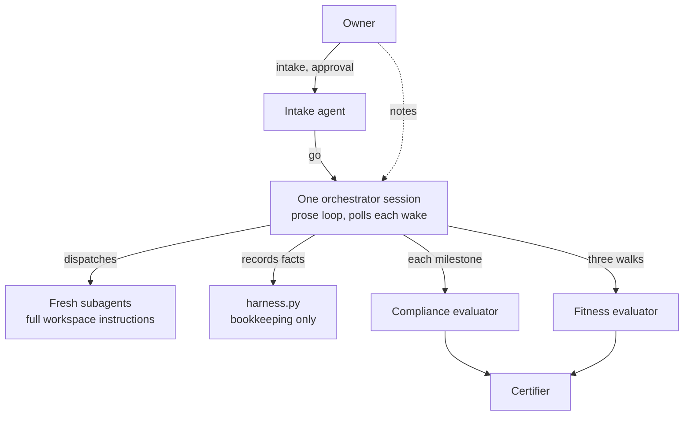
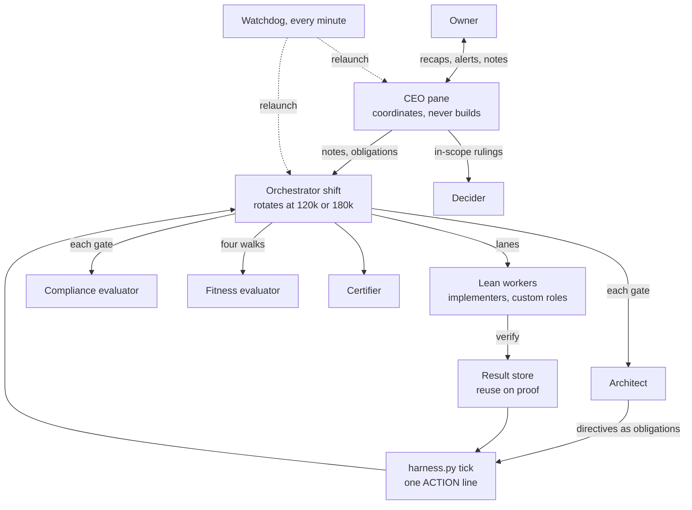
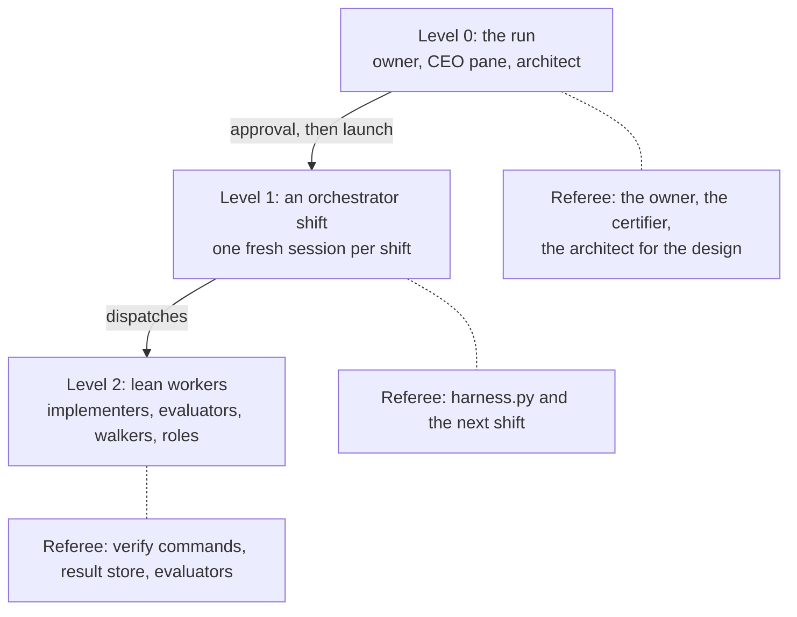
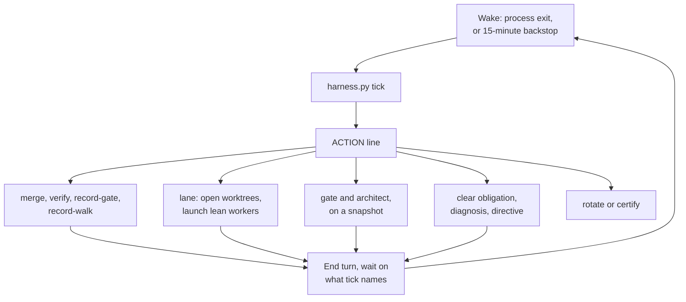

# The long-run harness architecture

## What it is

`long-run` is a Claude Code skill that turns a goal stated in conversation into work that runs unattended for hours or days, until an independent agent certifies it done. A **harness** is the loop and rules that keep an agent working toward a goal: what it reads at the start, what it may change, who checks its work, and when it stops.

The **owner** is the person who sets the goal, approves the run and makes the decisions no agent should make alone. The owner is present for the intake and the final review, and talks to the run in between through one session, the **CEO pane**.

One run serves one complex goal, for as long as it takes and as fast as the machine allows.

**When not to use it.** A goal that fits in about an hour needs a plan and one session. A goal that a dedicated, proven skill already handles goes to that skill.

The skill has six modes:

| Mode | Who runs it | What it does |
| --- | --- | --- |
| `new <goal>` | Owner and agent | Intake, foundation, approval, launch |
| `supervise <RUN_DIR>` | The CEO pane | The owner's interface to the run |
| `shift <RUN_DIR>` | Orchestrator, unattended | One orchestrator shift |
| `status <RUN_DIR>` | Anyone | Summarises the run's state |
| `note <RUN_DIR> <text>` | Owner | Steers a live run, answers rulings |
| `resume <RUN_DIR>` | Anyone | Relaunches a stopped run |

## Original sketch vs. now

The skill was first sketched in a design spec on 2026-10-20 (the v0.1 design). Version 0.2 turned it into code and ran it once on a real product: Deckwright, a Commander deckbuilding skill. That pilot logged its problems as numbered **pilot findings** (P-01 to P-54 in the skill's findings file). Version 0.3, current at v0.3.4, is the rebuild that answers them. Every one of the 54 findings is either fixed with a commit and a test (51) or accepted with the owner's words (3).

| Component | Originally sketched (v0.1) | Now (v0.3) | Why it changed |
| --- | --- | --- | --- |
| Owner's interface | Owner writes notes to the orchestrator | The CEO pane: one session, coordinates, never builds | Supervisor spent its context on work it should delegate (P-09); owner ruling |
| CEO pane context | Not sketched | Heads-up at 400k tokens, forced rotation at 600k via `launch_ceo.sh` | Owner ruling; a handoff once left the run unwatched 4 h (P-13) |
| Who runs the loop | Prose orchestrator over a bookkeeping script | `harness.py tick` prints one ACTION line; the shift acts on it | Gates slid late, notes went unread, polling was costly (P-26, P-04, P-15) |
| Open items | Notes in a file | One obligations primitive that blocks dispatch, merge or certify | A closing plan was acknowledged and never done (P-14) |
| Orchestrator lifetime | One session; rotation awaited a ruling | Shifts rotate at 120k tokens at a gate, 180k anywhere | Cost is context times turns (P-33) |
| Waiting | Poll every wake | Wait on the process's exit; 15-minute backstop | One waiting shift spent 25.2M cache-read tokens in an hour (P-15) |
| Verifying | Every verify runs every time | Result store: reuse a result only on proof it is current | Full re-verifies cost hours; stale records overwrote new ones (P-10, P-18) |
| Workers | Fresh subagents with the full workspace instructions | Lean `claude -p` workers, rule-coverage check, detached | 47k-token floor per turn (P-33); a cut must name what it removed (P-35) |
| Design ownership | None beyond the gate evaluator | Architect at every gate and on triggers; ARCHITECTURE.md | A skeleton shortcut became the architecture (P-22, P-32) |
| Pipeline stages | Capability features only | One integration feature per stage, proven by observed reads | A core capability was built and never called (P-23) |
| Scope after freeze | Findings triaged into work or questions | An addition needs a source finding and a decision naming the job | 126 features grew to 158 (P-08, P-19) |
| Stuck work | Five-rung stall ladder | Per-feature trigger opens a diagnosis with a root-cause class | The diagnosis rung never fired (P-11, P-20) |
| Fitness walks | Three: skeleton, 60%, final | Four: adds 85%; delta walks; owner-style session | The final walk discovered instead of confirming (P-27) |
| Usage | A set share of the weekly allowance; pause near 80% | Pause at 98% of either window; no token budget, no pacing | Owner ruling: quality over usage, no speed cap |
| Time ceiling | Not sketched | 48 h wall clock, extendable, never a pace | Owner ruling |
| Rulings | Every question to the owner | A delegated decider settles in-scope questions | Questions waited although the owner's words already answered them (P-44) |
| Releases | Nothing ships before certification | Interim releases, notice only | 130 of 138 features passed mid-morning and nothing shipped (P-31) |
| Intake | Green field only | Also brownfield: `init --from`, triage, baseline | The first v0.3 run rebuilds the pilot's product (owner request) |
| Worker roles | Fixed set | Custom roles per run, with their own prompt and environment | Added for the rebuild's knowledge lane |
| Machine load | Instrument lock and a fan-out cap | Lane cap with a time window, machine-wide verify slots | Overlapping verifies loaded the machine (P-05, P-46) |
| Liveness | Heartbeat watchdog | Liveness from the script's records first; the CEO pane is watched too | The watchdog killed working shifts twice (P-06, P-02) |
| Release-ready skill | Four test rungs | Three checks: tests and rule coverage, findings gate, delta review | v0.3 was declared ready with findings undecided (P-37) |
| Cost visibility | Evaluator dispatch count | `run_cost.py` meter: weighted tokens per role and per feature | The pilot used about 40% of a weekly budget (P-33) |
| `/goal` guard | Set at launch as the stop condition | Dropped | The script's states and the tick replaced it |

### The biggest shifts

**A script now decides the loop.** The sketch kept a model in charge of what to do next and gave the script only the facts. In the pilot that model let milestone gates slide to the end of the day, ignored notes and spent most of its tokens polling. Now one deterministic call decides every mechanical step and prints it as one line. The orchestrator makes the judgment calls that remain.

**v0.3 adds a design owner.** The sketch had evaluators that checked each milestone but no role that held the design across shifts. The pilot passed 158 of 158 features and still missed its goal, because a shortcut taken at the walking skeleton was never replaced. v0.3 adds an architect at every gate, an architecture record, and one integration feature per designed stage, each proven by what its check actually read.

**The owner now has one interface.** The sketch let the owner talk to the orchestrator directly. v0.3 puts a CEO pane between them, which coordinates and never builds. It is watched and relaunched like a shift, rotates at a fixed context size, and settles the questions it can through a delegated decider.

**Cost is now measured and is not throttled.** The sketch planned a usage share and a pause near 80%. The owner ruled that out: no token budget, no pacing, a pause only just before extended usage credits. Cost now comes down by design: lean workers, short shifts, result reuse on proof, and waiting on processes instead of polling.

<!-- diagram: sketch -->

<!-- diagram: now -->

## The three levels

The run nests three harnesses. Each level has its own unit of work, its own task list, and a referee that sits outside it.

Every level has the same eight properties:

| Property | Meaning |
| --- | --- |
| Unit | One bounded piece of work |
| Task list | Written to disk before starting |
| Start routine | Fixed reads, same order |
| End point | Writes an output file |
| State | Disk and git only |
| Referee | Something other than itself |
| Caps | Rounds, time, context |
| Stall rule | Measured progress, then a named act |

| Level | Unit | Task list | End point | Referee |
| --- | --- | --- | --- | --- |
| 0: the run | The whole run | BRIEF, JOBS, INVENTORY, ARCHITECTURE, APPROVAL | CERTIFICATION.md | Owner, certifier, architect |
| 1: a shift | One shift | The ACTION line, `shifts/NN-plan.md` | `shifts/NN-report.md` | harness.py, next shift |
| 2: a worker | A batch, gate, walk or review | Its brief | Its output file | Verify, evaluators |

The script refuses a pass claim that a worker's stored results do not support, and it writes the facts block of each shift report itself.

## Level 0: intake, foundation and approval

Level 0 asks every question only the owner can answer before the run starts, and nothing the owner could not answer.

### 1. Scale the intake

| Goal type | Questions |
| --- | --- |
| Rulebook plus a domain pack | None, brief only |
| Known domain | Up to 5 |
| Novel or ambiguous | Up to 12 |

A **domain pack** is a library of probes and edge cases for one kind of product, grown from earlier runs. Questions go one at a time, ranked by impact times uncertainty, each with the intake agent's recommended answer. The owner's words go into `BRIEF.md` verbatim.

### 2. Mechanism goals

For every mechanism the design names, intake asks what it exists to achieve and writes the answer as a **mechanism goal** in JOBS.md, with a probe that fails without the mechanism. Deckwright's design searched rating ladders so a deck would get the best cards available now. That goal was never written down, so the build took a shortcut and nothing failed.

Intake also records production reach (which systems the run may write, and how each write is rolled back), the project's QA path, untracked data the checks read, and any sealed material builders must never see.

### 3. Interaction inventory

The **interaction inventory** (`INVENTORY.md`) has one row per input of the product, not a sample: the field, the values it takes, the control a user sees, the predecessor's control, and the default chosen. Checks then target the control a person uses. An earlier run without this table passed 353 tests and shipped a single dropdown where the user needed to pick several values.

### 4. Builder check and run classification

The **builder check** is a fresh agent that reads the brief as the person who must build the result and lists every question it would need answered. The intake agent answers the minor ones itself as logged calls. The owner sees only the questions that need the owner, in one batch.

A **flat** run's "done" is checkable today. A **staged** run's "done" depends on answers the run must find on the way.

### 5. Foundation work

- **Research** into reference products and prior art.
- **Readiness probes.** Each property is set with the build tool and read back with the fitness instrument (the tool a user would use, such as a browser). Anything no tool can perceive is raised now as a blind spot.
- **Spec and design**, with an edge-case matrix and mockups for anything user-facing.
- **ARCHITECTURE.md**: the pipeline stages and the module that owns each, single owners of shared facts, stored artifacts and their readers, hot files (files many features touch), and the release plan.
- **Rubric** (`RUBRIC.md`): every criterion cites a user job, a mechanism goal or a do-not-regress item. No criterion rewards resemblance to a historical reference unless a job asks for it.
- **Plan** (`features.json`): one small feature per behaviour, each with a verify command, one integration feature per designed stage, and release 1 as the smallest set that does the core job. `harness.py check-plan` refuses a plan without them.
- **AGENT-BRIEF.md**: the hard rules, secrets rules and banned commands, pasted verbatim into every dispatch.

### 6. The one-page approval

`APPROVAL.md` takes about 10 minutes to read: the jobs and mechanism goals, the inventory, every default chosen, open questions, probe results and blind spots, the run shape and releases, production reach and the QA path, the permission rules the owner approves once, and when the first playtest should arrive. The owner does not read the rubric. There is no token budget on the page; the run reports tokens per feature instead.

On "go", the script freezes JOBS, INVENTORY and RUBRIC, `preflight` checks the permission rules and installs the watchdog, and shift 1 starts in a fresh session. The intake session stays and becomes the CEO pane.

### 7. Brownfield: rebuilding from a prior run

When the goal rebuilds a product an earlier run built, the old features are not the spec. The owner's feedback and the original design intent are.

1. `init --from <prior run>` copies the intake files, the worktree and the budget. Prior pass records are never imported: they were made under an older harness and design.
2. `triage flag-text` marks old features whose text encodes a design departure. Each old feature is then set to keep, rewrite or retire, and a flagged one needs a logged decision.
3. `triage import` writes the kept features as do-not-regress items.
4. `baseline` runs every kept feature's verify fresh at the product's current commit. Its failures are known-red, so a later break is a true regression.
5. ARCHITECTURE.md is written from the original design before planning, and the architect reviews it before the first worker starts. Where the design was bypassed, the plan holds a removal feature plus the stage's integration feature, which starts red.

## The CEO pane

The session that ran the intake does not end at launch. It becomes the **CEO pane**, the one place the owner talks to the run. Shifts act as program managers and workers as individual contributors. Every alert, release notice, ruling and digest reaches this pane first.

**It coordinates and never does the work.** It has two channels: spawn its own subagents (research, diagnosis, harness repair, anything that reads logs or code), or send the shift the work as a note, an obligation or an architect directive. It never builds, never dispatches workers into the run, and never runs the shift's commands, because two orchestrators would race.

- **Recaps on a fixed clock.** A cron job runs `supervise_tick.py` every 10 minutes on an off-minute. Each tick prints a recap line, a "Now" line with measured times per active worker, and any alerts. When the owner is away, the cadence drops to hourly and a one-page digest goes out at a set time.
- **Reads the plan.** `harness.py plan` renders milestones, releases, the critical path, features added since the freeze by source, open obligations, and the next gates and walks. It is generated from the run's files, never a second record.
- **Reads the architect** and steers with decisions, directives and release moves.
- **Relays the owner** with `note`, which stamps each entry with the clock time. The shift's next tick turns each new note into an obligation it must acknowledge.
- **Settles rulings it can.** A new question for the owner first goes to a **decider** subagent, which reads the run's strategy and the one question and writes a decision. In-scope decisions are recorded as delegated, marked as not the owner's words. Scope cuts, production reach, spending, outside contact, changes to the owner's own rulings and matters of taste still go to the owner.
- **States no unmeasured durations.** Any elapsed time it reports comes from a command or a transcript timestamp, or is reported as "not measured".

**Its own context is capped.** From 400k tokens the tick prints a heads-up. At 600k it alerts that the pane must rotate. Rotation goes only through `launch_ceo.sh`, which renders a level-0 handoff, refuses unless the handoff lints clean, and starts the new pane in its own tmux session. Step 1 of that handoff re-arms the recap cron. The old pane keeps its cron until the new pane recaps once, then ends. The watchdog relaunches the pane through the same script when its recap is two cadences late or its session is gone, and falls back to email and phone push if the relaunch fails.

**Sanctioned routes.** Each routine action has one route, so a permission denial never turns into a question for the owner:

| Action | Route |
| --- | --- |
| Rotate a shift | `ROTATE NOW` note; the shift rotates itself |
| Kill a stale session | Watchdog, or `launch_shift.sh` |
| Stop a stale verify | `stop-job` by its pid file |
| Lower or raise load | `lanes-cap N`, optionally with a time window |

## Level 1: the orchestrator shift

The **orchestrator** carries out what the script decides and makes the judgment calls it cannot: triage a failure, classify a finding, write a decision. It never builds, never judges a gate, and never asks a question in chat, because no one is watching its session.

### 1. The tick and the ACTION line

Every wake runs `harness.py tick`. It starts or continues the shift, records the heartbeat, reads the shift's context size from its own transcript, checks the environment and usage, reads new owner notes, and prints one ACTION line: a list of clauses such as `merge L2`, `verify failing`, `gate B`, `architect B`, `walk 3 final`, `lane F-1,F-2`, `clear OB-4`, `rotate` or `wait`. The shift does each clause in order. When the skill or protocol files change, tick prints `PROTOCOL-CHANGED` and the shift re-reads them.

### 2. Obligations

An **obligation** is an open item that blocks dispatch, merge or certification until its named act clears it. One primitive carries owner notes waiting for acknowledgement, architect directives, closing punch items, a design departure awaiting its decision, a diagnosis owed for a stuck feature, and hard lint findings. The shift cannot pass one by: the command it needs refuses until the obligation clears with evidence.

### 3. Waiting on workers

On `wait`, the shift ends its turn waiting on the item tick names: a worker launched in the background wakes it when it exits, and a long job's pid is waited on directly. Every turn also schedules a backstop wakeup at 15 minutes while work is in flight. Workers run detached, so a shift rotation never kills them; the next shift attaches to them.

### 4. Lanes

Tick groups failing features into batches that touch different files and opens a **lane** for each: a separate git worktree branched from the run's current commit. Features that share a hot file go into one lane, or wait for the lane that holds it.

| Limit | Value |
| --- | --- |
| Implementer lanes | Up to 3 (owner may lower) |
| Workers at once, unattended | Up to 4 |
| When memory is under 8 GB | Up to 2 |
| Verify checks, machine-wide | Half the cores, at least 2 |

The lane cap can be set for a time window, such as fewer lanes during the owner's working hours, and returns to the standing cap afterwards.

When a worker's report exists, `report file` validates it and `lane merge` lands the lane. Landing reruns only the checks the merge can reach, in the background, and reconciles the worker's claims against the result. A report that lists a departure from the design opens an obligation that holds the merge until a decision or ADR (architecture decision record) accepts it.

### 5. Gates, with the architect beside them

A milestone's gate is due the moment its features pass, whatever other milestones are doing. A **compliance evaluator** tries to prove the milestone not done, on a read-only snapshot of that commit, so lanes for the next milestone keep building. At the same time the **architect** reviews the diff against ARCHITECTURE.md. The script refuses to record the gate round until the architect's review file exists.

Findings carry a class: fails a core job (becomes work), polish (at most 2 rounds) or new capability (a question for the owner, never added to the plan). A gate runs at most 3 rounds, then passes with residuals as a punch list. A round after the first reviews only the changes since the last round plus the open findings. At each gate the script also lists **dead capabilities**: designed modules or stored artifacts that no passing check has read yet.

### 6. Fitness walks

A **fitness walk** is a fresh agent that uses the product as a person would, through the fitness instrument, seeing only the jobs, scenarios, inventory and product. Walks fall at the walking skeleton (the first build where a core job works end to end), about 60%, about 85% and final. Each walk includes one owner-style session: an extreme request, then edits that push on limits. A walk after the first, other than the final, walks only the jobs that changed or failed plus one random control. At most 2 walks follow the final gate; after that the residuals go to the owner. Each walk produces a short PLAYTEST note, and the run never waits for an answer.

Where the goal has a quality bar, the 60% and final walks add a blind comparison against a reference product. The tally informs the owner and never blocks.

### 7. Closing and releases

When the remaining work is the endgame, the shift sets the run to **closing**. The script then refuses new features, tightenings and lanes unless a decision names a failing core job, and the punch list becomes obligations. The CEO tick alerts if the punch list has not moved for 30 minutes.

An **interim release** is cut when a release's features pass and its own walk passes. The cut tags the commit, writes a release note and sends the owner a notice; it never waits for approval. A production release happens only inside the reach declared at approval, and anything outside it becomes a blocking ruling. Downscoping moves a feature to a later release and never deletes it.

### 8. Rotation

The script decides rotation. A shift rotates at a gate boundary past 120,000 tokens, or anywhere past 180,000. It writes the plans part of its report, the script writes the facts block, and `launch_shift.sh` runs a launch canary (a short check for a first-open dialog or permission prompt), kills every older shift session, and starts the next shift in a detached tmux session. A stable viewer session follows the run across shifts.

Shifts launch lean, with the skill, the protocol and the product's own instructions in the system prompt and nothing else.

## Level 2: lean workers

Every worker is a fresh `claude -p` session started by `worker_launch.sh`, never through the Agent tool. It gets its role prompt, AGENT-BRIEF.md and the tools its role needs. It does not get the user-level instruction chain, memory or output style. It does get the product repository's own instructions, capped, with a warning if they are cut.

**The rule-coverage check.** Leaving out the workspace instructions could silently drop a rule a worker needed. `check_worker_rules.py --check` compares every rule in the workspace's agent instructions against a manifest that says where each one reaches workers and lean shifts. A new rule fails the check until it is classified, and the check must pass before a run.

| Role | When | Output |
| --- | --- | --- |
| Researcher | Foundation | research/NOTES.md |
| Builder check | Intake | Sorted questions |
| Planner | Foundation | features.json |
| Coverage evaluator | Foundation | Plan verdict |
| Implementer | Each lane | iterations/NN-impl.json |
| Custom role | Its features | The file its prompt names |
| Compliance evaluator | Each gate | gates/M-rN.md |
| Architect | Each gate, triggers | adrs/review-*.md |
| Fitness evaluator | Four walks | fitness/N.md |
| A/B judge | Quality walks | evidence/ab/N/TALLY.md |
| Approach proposer | Stuck features | stuck/F-diagnosis.md |
| Certifier | End of run | CERTIFICATION.md |

**Custom worker roles.** A run can define its own roles at intake, such as a parser or a judge, each with its own prompt, model, tools and environment variables. A feature tagged with a role is built by that role instead of the implementer, and its environment reaches that role only. Spend per role shows in the cost meter, and a cost alert is a notice only.

**Reports are JSON** with a fixed schema: feature ids, files touched, verdicts, departures from the design, learnings and the next action. **Models are routed:** implementers and first gate rounds on Sonnet; Opus for the planner, architect, approach proposer, final gate, certifier, and after two failures on one feature. A worker whose valid report exists counts as complete, and a process that lingers past it is stopped after 30 seconds.

## The architect

The **architect** is a fresh-context Opus review that owns the design across shifts. It reviews beside every milestone gate. It also runs a periodic review when any of these occur: a shift rotation at least 2 hours after the last review, feature growth of 3 features or 10%, whichever is larger, a second merge conflict on one file, any design departure, or 4 hours since the last review. Certification waits for each periodic review it owes.

It writes ADRs and directives. A directive is filed as an obligation, and one that needs product work reaches a builder through its brief. The architect never dispatches, so two orchestrators never race.

## The result store

A check's result is stored once, under a key, and reused only with proof that it is still current.

- **The key comes from what the check actually read.** A read tracer runs each verify with an audit hook in every Python process, plus `strace` for other commands, and hashes every file, listing and data store it opened. The command, the toolchain lock, the harness version and declared data inputs join the key. Paths are written relative to the worktree, so a snapshot and the live worktree give the same key.
- **Only hermetic checks are reusable.** A check that touches the network, the clock or unseeded randomness is recorded as not reusable and always reruns.
- **Results are immutable.** A result is written once when its check finishes, and a write older than the stored record is refused.
- **A canary reruns reused results fresh.** After 20 reuses, or 25 ticks with at least one, tick reruns a sample. A mismatch means a key missed an input: that class of check is invalidated and a harness finding is filed.
- **A reused result is known to be current; only a fresh run judges whether it is correct.** Gates, walks and certification judge fresh. Certification runs every check once more, fresh, in parallel, and that run must match the store exactly. A difference is a harness finding that blocks certification.

At close, the store moves with the run directory to the project that owns the work, so the next run starts from what is still provably current. The run's **memory** moves with it: one fact per file, written only through `learn` and `decide`, with a generated index and briefs that paste only the facts whose scope overlaps the dispatched features.

## What harness.py owns

`harness.py` is the command-line front of a Python package. It owns the facts the agents could otherwise misreport, and every deterministic step of the loop:

- **Only `verify` marks a feature passing.** Nobody hand-edits STATE.json.
- **It writes the facts block of every shift report.**
- **It reads verdicts from evaluator files**, never from a summary.
- **It numbers decisions** and refuses an added feature without a source.
- **It lints the run** every fifth tick and at each gate: brief sizes, whole-file reads in briefs, context past the rotation thresholds, index drift, and disk footprint. A hard finding becomes an obligation.

Every command prints one machine-readable first line and exits with a fixed code:

| Code | Meaning |
| --- | --- |
| 0 | OK |
| 2 | Usage error |
| 3 | Refused, frozen or rule |
| 4 | Environment fault |
| 5 | Budget exceeded |
| 6 | Not ready or not passing |
| 7 | Usage paused |

**Who may change a check.** Any agent may tighten a check. Only the owner may loosen one, and a loosening needs the owner's words recorded in a ruling. A delegated decision may stand in only for an in-scope issue, and never defers a core job, cuts scope or changes one of the owner's rulings.

## When work gets stuck

After 4 failed build attempts on one feature, or a feature failing again after passing twice, tick opens a **diagnosis** obligation that blocks any retry. The approach proposer reads the attempts record and writes a diagnosis with a root-cause class (bug, check stricter than the spec, flaky, stale record, feature conflict) and a principle step: name the principle the defect violates and fix it at its owner. The next tick prints the action for that class.

A feature is deferred only after the diagnosis's recommendation failed. A core feature cannot be deferred without the owner's ruling, and nothing is deferred to protect a check.

Two run-wide alarms back this up. No new passing high in 90 minutes raises a convergence alert. A worker, shift or subagent busy for 20 minutes and 40 reads without a write or commit raises an alert in the CEO pane, and at twice that time the shift owes a look at it.

## Rulings and staged runs

A question for the owner becomes a **ruling** entry (`JR-NN`) with options, a recommendation, what it blocks, and a provisional default. Work built on a default carries `provisional: JR-NN`, so it can be reopened. Only a blocking ruling can stop the run; a non-blocking one never does. The orchestrator's own calls are **decisions** (`D-NN`).

A **staged run** is for a goal whose answers create the next questions. The planner writes only the next stage in full. Each stage states its expected sizes and counts up front as **tripwires**; when reality differs, the stage stops and opens a blocking ruling with a re-plan.

## The guards

### Frozen files

JOBS.md, INVENTORY.md and RUBRIC.md are hashed and made read-only at approval, along with each feature's behaviour and verify command. Every gated command checks the hashes first. A tightening re-freezes through a logged decision, and a changed verify is syntax-checked at freeze.

### Banned commands and sealed paths

`guard_unattended.py` is a hook that runs before every tool call in the run's sessions. It denies, and names the safe alternative for, `git push`, destructive git resets and cleans, recursive force deletes, `sudo`, broad process kills, writes under `~/.claude/` or `/tmp/`, writes to frozen files or STATE.json, anything mentioning extended usage credits, and rewriting a script while a live process runs it. Sealed paths, such as held-out test sets, are denied to every role but the ones allowed.

### Usage and time

Each wake checks the 5-hour and 7-day usage windows. At 98% of either, the run pauses until the window resets, then the watchdog resumes it. The run never uses extended usage credits. There is no token budget, no spend pause and no pacing.

The wall-clock ceiling defaults to 48 hours, or the prior run's for a rebuild, and `budget --set-hours` extends it with a log entry. The ceiling stops the run and never sets its pace. If intake set an evaluator-dispatch estimate for a milestone, the run also stops for a ruling at twice that estimate.

### Watchdog

`watchdog.py` runs from cron every minute and calls no model.

| Condition | Action |
| --- | --- |
| Finished, paused, or in intake | Skip |
| Usage paused, window reset | Resume |
| Blocked, owner answered | Resume |
| No session, heartbeat over 2 min | Relaunch |
| Session, heartbeat over 3 min | Check the script's records, then the pane |
| Pending workers or lanes in records | Leave it alone |
| Pane shows a prompt | Alert, never kill |
| Pane idle | Kill, relaunch |
| 3 relaunches in 6 hours | Pause, notify |
| CEO recap two cadences late | Relaunch the CEO pane |
| Run finished | Close its sessions |

## Timing

| Timer | Value |
| --- | --- |
| Shift wakeup backstop | 15 min |
| CEO recap | 10 min, hourly when away |
| Watchdog cron | 1 min |
| Stale heartbeat, no session | 2 min |
| Hung check, live session | 3 min |
| Busy without output | 20 min and 40 reads |
| Convergence alert | 90 min |
| Punch list not moving | 30 min |
| Architect periodic review | At most 4 h apart |
| Relaunch cap | 3 per 6 h |
| Usage ceiling | 98% |
| Wall-clock ceiling | 48 h, extendable |
| Shift rotation | 120k at a gate, 180k anywhere |
| CEO pane | Heads-up 400k, rotate 600k |

## Certification

1. `certify-ready` refuses while any feature fails, a PLAYTEST note is missing, a defect or job-failure finding is open, an obligation blocks certification, or an owed architect review is missing.
2. `verify --certify` runs every check fresh, and it must match the result store exactly.
3. The **certifier**, a fresh agent, reads the script's records, re-runs a sample, checks every owner and delegated ruling against its source, and writes CERTIFICATION.md.
4. The run stays certified-pending until the owner's final review, then it is finished. `finish` writes the timeline and a draft retrospective, including proposed follow-on goals as rulings.
5. Each miss the owner caught becomes a probe in the domain pack, and each harness miss becomes a test fixture.

## When a new skill version is ready

"Ready" for a new version of the skill means three checks pass, with no judgment call:

1. The test suite and `check_worker_rules.py --check` pass.
2. `check_findings_done.py --check` passes: every pilot finding is fixed with a commit and a test, or accepted with the owner's words.
3. A **delta review**, a fresh reviewer given only the diff since the last review and its open findings, finds nothing new that blocks.

The last delta review before release mutated the code 30 times against the tests that claim to cover each fix; the tests caught 27. The 3 that survived were an untested fallback path and two redundant checks. A toy run is also required before the first long run on a machine and after any change to the scripts or the shift protocol.

## Testing the harness

The **toy run** is a small command-line tool with known answers, set up by one script, with intake pre-written and rotation thresholds lowered. Faults are injected by hand: a killed shift, a lingering worker, a rotation with workers in flight, a closing state forced by a directive. The results log holds 29 entries from 2026-10-20 to 2026-10-23, a few of them covering more than one toy. Most certified in 0.2 to 0.7 hours with no permission prompts, and several stopped on purpose as drills.

Not yet exercised live, by the toy log's own account: the CEO pane's 600k rotation (a toy has no CEO pane; a dry run rendered and linted its handoff), the time-windowed lane cap, the decider subagent itself (its output was seeded by hand), and cross-run reuse.

## Cost: what is measured so far

Weighted tokens are input-price equivalents: cache reads at 0.1, cache writes at 1.25 and output at 5 times the input price. `run_cost.py` is the skill's cost meter.

| Measure | Before | Now | Source |
| --- | --- | --- | --- |
| Pilot cost per feature | 2.55M weighted | Not yet comparable | `run_cost.py` on the pilot to its close, 402.2M over 158 features |
| Worker first turn | 47k median | 6,370 on Deckwright, as the skill records it | Pilot finding P-33; skill notes, 2026-10-22 |
| Rebuild implementer first turn | | 17k median, 81 sessions | `run_cost.py` on the live rebuild, 2026-10-22 22:40 PT |
| Shift first turn | 68k | 51k with lean shifts | Toy runs b69417b and 610d10c |
| Toy cost per feature | 2.7M and 5.6M (two v0.2 toys) | 0.69M to 1.72M | Toy results log |
| Compliance round, toy | 0.20M | 0.15M | Toy results log, toys 0816 and 0902 |

**No whole-run saving is shown yet.** Per-unit costs fell: a compliance round costs about a quarter less, and workers start far smaller. The whole-run cost per feature on toys still swings with the product. One v0.3 toy passed every gate first time at 0.69M per feature; another took six gate rounds and four failed walks and reached 1.34M before certifying. That spread is larger than any saving the delta mechanisms could make, so the difference is product variance. The rebuild of Deckwright, running now, is the first real measure.

## What the first run taught

The first real run built Deckwright: 126 planned features over six milestones, with a 48-hour budget. It ran 22 hours over 12 shifts and reached 158 of 158 features passing on its own records, after 29 gate rounds. The owner then paused it uncertified to test the product by hand. The harness kept the run alive, but the run drifted from its goal and never reached certification. In 35 minutes of hands-on use, the owner found 22 issues, 10 of them product defects no verify caught.

| Rank | Issue | Impact | v0.3 answer |
| --- | --- | --- | --- |
| 1 | Design drift | Missed the goal | Integration feature per stage, mechanism goals |
| 2 | No architecture owner | Drift went unseen | Architect at gates and on triggers |
| 3 | Owner-found defects | 22 issues, 35 min | Owner-style walk session, probes |
| 4 | Endgame did not converge | About 10 h tail | Closing state, stall trigger, 85% walk |
| 5 | Scope grew after freeze | 126 to 158 | Additions need a job and a decision |
| 6 | Verify cost and noise | Hours re-testing | Result store, snapshot verifies |
| 7 | Supervision gaps | 4 h unwatched | Recap cron, watchdog relaunches the CEO pane |
| 8 | Permission stalls | Owner round trips | Allow rules at approval, sanctioned routes |
| 9 | Notes did not bind | Plans ignored | Notes become obligations |
| 10 | Polling and context cost | 25.2M tokens/h | Wait on exit, lean context, short shifts |
| 11 | Merge hotspot, serial flags | 5.3 h lane time | Hot-file batching, named serial writes |
| 12 | Late milestone gates | Late findings | Gate due when its features pass |
| 13 | Watchdog liveness | Lanes lost | Liveness from the script's records |
| 14 | Owner visibility | View and releases | Stable viewer, interim releases |
| 15 | Machine load | Slowed the owner | Lane cap windows, verify slots, nice |
| 16 | Record-keeping holes | Unreliable facts | Script-numbered decisions, sourced additions |

In the top-ranked issue, design drift, the design drew candidate cards from rating ladders over every legal card. The walking skeleton took a shortcut and drew them from one popularity site's page, and nothing ever replaced it. The ladders were built and stored (68,450 rating rows), yet nothing on the build path read them; in 19 saved builds, 94% of picks came from that one page. No feature stated the integration "the build's candidates come from the ladders", so its absence failed nothing.

## Design principles

- **Every level has an outside referee**, including the orchestrator, whose shift facts the script writes, and the design, which the architect referees.
- **The fitness walk checks the job** through the instrument a user would use; tests check the code.
- **Criteria come from the user's jobs**, never from the thing under test.
- **Scripts hold the facts and decide the loop; models make the judgment calls.** The product ships as deterministic code, and any check a script can run becomes a script.
- **Every designed stage has an integration check, and every stored artifact has a reader.**
- **Scope added after the freeze names a job.**
- **The owner is asked only what only the owner can answer**, before the run and in batches, while work continues on defaults.
- **Every check names the failure it prevents** and runs at the cheapest point that still catches it.
- **Quality, cost and speed are judged together.** The budget is a ceiling and never sets the pace.
