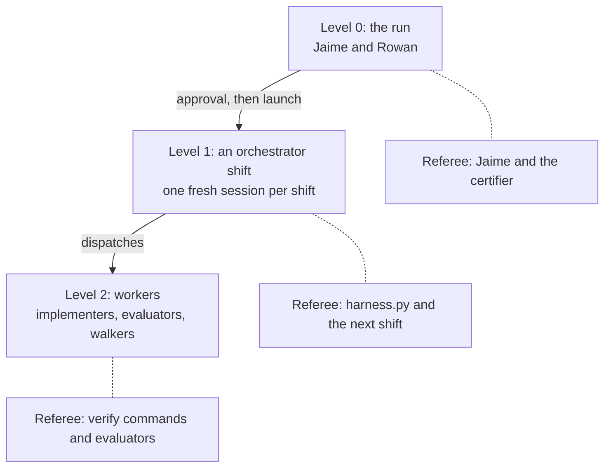
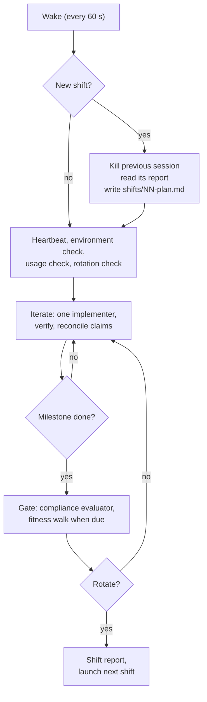

# The long-run harness architecture

## What it is

`long-run` is a Claude Code skill that turns a goal Jaime states in conversation into work that runs unattended for hours or days, until an independent agent certifies it done. A **harness** is the loop and rules that keep an agent working toward a goal: what it reads at the start, what it may change, who checks its work, and when it stops.

**When not to use it.** A goal that fits in about an hour needs a plan and one session. A goal a dedicated skill already handles well, such as `new-game` for multiplayer browser games, goes to that skill.

The skill has five modes:

| Mode | Who runs it | What it does |
| --- | --- | --- |
| `new <goal>` | Jaime and Rowan | Intake, foundation work, approval, launch |
| `shift <RUN_DIR>` | Orchestrator, unattended | One orchestrator shift |
| `status <RUN_DIR>` | Anyone | Summarises the run's state |
| `note <RUN_DIR> <text>` | Jaime | Steers a live run, answers rulings |
| `resume <RUN_DIR>` | Anyone | Relaunches a stopped run |

## The three levels

The run nests three harnesses. Each level has its own unit of work, its own task list, and a referee that sits outside it. The orchestrator works in fresh context windows with a task list and fixed start and end points, the same as the builders, at a coarser grain.

Every level has the same eight properties:

| Property | Meaning |
| --- | --- |
| Unit | One bounded piece of work |
| Task list | Written to disk before starting |
| Start routine | Fixed reads, same order |
| End point | Writes an output file |
| State | Disk and git only |
| Referee | Something other than itself |
| Caps | Rounds, time, budget |
| Stall rule | Measured progress, a ladder |

| Level | Unit | Task list | End point | Referee |
| --- | --- | --- | --- | --- |
| 0: the run | The whole run | BRIEF, JOBS, INVENTORY, APPROVAL | CERTIFICATION.md | Jaime, certifier |
| 1: a shift | One shift | `shifts/NN-plan.md` | `shifts/NN-report.md` | harness.py, next shift |
| 2: a worker | A batch, gate or walk | Its brief | Its output file | Verify, evaluators |

A worker's reply is a claim, so the orchestrator re-runs the worker's checks itself. A shift's report would also be a claim, so the script writes the facts in it.

## Level 0: intake, foundation and approval

Level 0 is the only attended part. Its goal is to ask every question only Jaime can answer before the run starts.

### 1. Scale the intake

| Goal type | Questions |
| --- | --- |
| Rulebook plus a domain pack | None, brief only |
| Known domain | Up to 5 |
| Novel or ambiguous | Up to 12 |

A **domain pack** is a library of probes and edge cases for one kind of product, grown from earlier runs. Questions go one at a time, ranked by impact times uncertainty, each with Rowan's recommended answer. Jaime's words go into `BRIEF.md` verbatim.

### 2. Walk every input

The **interaction inventory** (`INVENTORY.md`) has one row per input of the product, not a sample: the field, the values it takes, the control a user sees, the predecessor's control, and Rowan's default. Checks then target the control a person uses. This is the fix for the ScryWatch miss, where a run passed 353 tests and shipped a single dropdown where the user needed multi-select chips.

### 3. Sort the questions

The **builder check** is a fresh agent that reads the brief as the person who must build the result and lists every question it would need answered. Rowan answers the minor pile himself as logged calls. Jaime sees only the "only Jaime" pile, in one batch.

### 4. Classify the run

A **flat** run's "done" is checkable today. A **staged** run's "done" depends on answers the run must find on the way.

### 5. Foundation work

Rowan then does the foundation work alone:

- **Research** into reference products and prior art (`research/NOTES.md`).
- **Readiness probes.** Each property is set with the build tool and read back with the fitness instrument (the tool a user would use, such as a browser). Anything no tool can perceive is raised now as a blind spot.
- **Spec and design**, with an edge-case matrix and mockups for anything user-facing.
- **Rubric** (`RUBRIC.md`): the pass criteria. Every criterion cites a user job or a do-not-regress item, never the existing implementation.
- **Plan** (`features.json`): one small feature per behaviour, each with a verify command the worker cannot argue with. A coverage evaluator checks the plan against JOBS and INVENTORY, at most 3 rounds.
- **AGENT-BRIEF.md**: the hard rules, secrets rules and banned commands, pasted verbatim into every dispatch.

### 6. The one-page approval

`APPROVAL.md` takes about 10 minutes to read: the jobs, the inventory, every default chosen, open questions, probe results and blind spots, the usage budget, the run shape, and when the first playtest should arrive. Jaime does not read the rubric.

On "go", the script freezes JOBS, INVENTORY and RUBRIC, sets the run to RUNNING, installs the watchdog cron line, and launches shift 1 in a fresh session, with none of the intake conversation in its context.

## Level 1: the orchestrator shift

The **orchestrator** is the agent that plans and dispatches. It does not build and it does not judge. It dispatches fresh subagents, runs the verify commands itself, records facts through `harness.py`, and keeps the run moving. It never asks a question in chat, because no one is watching the session.

A shift runs inside a `/loop` that re-enters the skill on every wake. Each turn ends with a 60-second wakeup.

### 1. Every wake

The shift reports its heartbeat and context size, checks the environment, checks the usage budget, and asks the script whether to rotate. A new shift first reads the previous shift's report, whose facts block the script wrote. Where the report's plans conflict with the facts, the facts win. If the previous shift crashed, committed work is credited before anything is planned, so no committed feature is built twice.

### 2. One iteration

The orchestrator picks 1 to 5 failing features from the current milestone and dispatches one **implementer**. Implementers run one at a time, because two in one git worktree collide on the index lock and test each other's half-written code. When the implementer's report file exists, the orchestrator runs `harness.py verify` on those features and reconciles the implementer's claims against the result. A claim the script did not see goes into the next brief as a fact. The implementer's hypotheses go into an **attempts record**, so the next implementer does not repeat a refuted theory.

### 3. Gate

At the end of a milestone, every feature is re-verified, changed test files are flagged, and a **compliance evaluator** tries to prove the milestone not done. The script reads the evaluator's verdict line from its file. Findings are labelled:

| Label | Becomes |
| --- | --- |
| DEFECT | Work |
| JOB-FAILURE | Work |
| POSSIBLE-FEATURE | A question for Jaime |

A gate runs at most 3 rounds. After round 3 the evaluator writes PASS-WITH-RESIDUALS with the open findings as a punch list. Wrong results, hard-rule violations and job failures block without limit; polish gets 2 rounds.

### 4. Fitness walks

A **fitness walk** is a fresh agent that uses the product the way a person would, through the fitness instrument. It sees only the jobs, the scenarios, the inventory and the product, never the code or the rubric. Walks happen at the walking skeleton (the first build where a core job works end to end), at about 60% of features passing, and on the final build. Each walk produces a short PLAYTEST note for Jaime. The run never waits for his answer; it continues on defaults and tags dependent work.

Where the goal has a quality bar, the 60% and final walks add a **blind comparison**: a judge sees shuffled screenshot pairs from the build and from a reference product and picks the better one. The tally informs Jaime and never blocks.

### 5. Rotation

A shift ends at a gate boundary once context passes the soft threshold (350,000 tokens), or anywhere at the hard threshold (550,000 tokens). It writes the plans part of its report, the script writes the facts block, and `launch_shift.sh` starts the next shift in a new detached tmux session (a terminal session that keeps running with no window attached). The new shift kills the old session. Jaime's ruling, 2026-10-20: "if an orchestrator needs to rotate for context then by all means allow it to rotate."

## Level 2: the workers

Every worker is a fresh subagent with a prompt file in `agents/`. Its dispatch is built by `harness.py brief`, which pastes AGENT-BRIEF.md and the relevant records. The orchestrator waits for the worker's output file to exist, not for its reply.

| Role | When | Output |
| --- | --- | --- |
| Researcher | Foundation | research/NOTES.md |
| Builder check | Intake | Sorted questions |
| Planner | Foundation | features.json |
| Coverage evaluator | Foundation | Plan verdict |
| Implementer | Each iteration | iterations/NN-impl.md |
| Compliance evaluator | Each gate | gates/M-rN.md |
| Fitness evaluator | Three walks | fitness/N.md |
| A/B judge | Quality walks | evidence/ab/N/TALLY.md |
| Approach proposer | Stuck work | A new approach |
| Certifier | End of run | CERTIFICATION.md |

Every worker ends with one of four statuses: DONE, DONE_WITH_CONCERNS, BLOCKED or NEEDS_CONTEXT. The last two go back to the orchestrator.

## What harness.py owns

`harness.py` is a bookkeeping script. It never chooses work. It owns the facts the agents could otherwise misreport:

- **Only `harness.py verify` marks a feature passing.** Nobody hand-edits STATE.json.
- **It writes the facts block of every shift report**, so a shift cannot misreport what it did.
- **It reads verdicts from evaluator files**, not from the orchestrator's summary.
- **It prints a `NEXT:` line** where the next step is mechanical.

Every command prints one machine-readable first line and exits with a fixed code:

| Code | Meaning |
| --- | --- |
| 0 | OK |
| 3 | Refused, frozen or rule |
| 4 | Environment fault |
| 5 | Budget exceeded |
| 6 | Not ready or not passing |
| 7 | Usage paused |

**Who may change a check.** Any agent may tighten a check. Only Jaime may loosen one, and a loosening needs his words recorded in DECISIONS. Each tightening is a logged decision that re-freezes the changed file.

## When work gets stuck

The **stall ladder** gives every stuck feature a next step, in this order.

### 1. Retry with the attempts record

The retry gets which theories were tried and refuted, never the raw failure output. A model that sees its own failed output tends to repeat it.

### 2. Try a different method

If the spec names an oracle (a known-good implementation or reference output), use it to locate the fault.

### 3. Ask the approach proposer

A fresh agent reads the attempts record and recommends a new approach.

### 4. Defer

Only after rungs 1 to 3 failed. A core feature cannot be deferred without Jaime's ruling, and nothing is deferred to protect a check.

### 5. Notify Jaime

If every remaining feature waits on Jaime, the run goes to BLOCKED-ON-JAIME and the shift stops its loop. The watchdog resumes it within a minute of Jaime answering a ruling or adding a note.

## Rulings and staged runs

A question for Jaime becomes a **ruling** entry (`JR-NN` in JAIME-RULINGS.md) with options, a recommendation, what it blocks, and a provisional default. Work built on a default carries `provisional: JR-NN`, so it can be reopened if he rules differently. Rowan's own decisions are **calls** (`D-NN` in DECISIONS.md).

A **staged run** is for a goal whose answers create the next questions. The planner writes only the next stage in full. A stage ends at the next ruling that blocks the critical path. Each stage states its expected sizes and counts up front as **tripwires**; when reality differs, the stage stops and opens a blocking ruling with a re-plan. The metric is Jaime-minutes per ruling, not agent hours.

## The guards

### Frozen files

JOBS.md, INVENTORY.md and RUBRIC.md are hashed and made read-only at approval, along with each feature's behaviour and verify command. Every gated command checks the hashes first and refuses on a mismatch. A tightening re-freezes through a logged decision.

### Banned commands

`guard_unattended.py` is a PreToolUse hook (it runs before every tool call) registered for the run's sessions. It denies, and names the safe alternative for:

- `git push`, `git reset --hard`, `git checkout --`, `git restore`, `git clean`, forced branch deletes
- recursive force deletes, `sudo`, `pkill`, `killall`, and killing any tmux session but this run's own
- any write under `~/.claude/` or `/tmp/`, to a frozen file, or to STATE.json
- anything mentioning usage credits or extra usage

It costs about 20 ms per call. An internal error allows the call and logs it, and every denial is logged with the full command.

### Usage ceiling

Each wake checks the 5-hour and 7-day usage windows. At 80% of either, the run goes to USAGE-PAUSED with a resume time set to that window's reset, and the shift ends. The run never uses extended usage credits.

### Watchdog

`watchdog.py` runs from cron every minute and calls no model. For each registered run:

| Condition | Action |
| --- | --- |
| Finished, paused, or in intake | Skip |
| USAGE-PAUSED, window reset | Resume |
| BLOCKED-ON-JAIME, he wrote | Resume |
| No session, heartbeat over 2 min | Relaunch |
| Session, heartbeat over 3 min | Read the pane |
| Pane shows a prompt | Alert, never kill |
| Pane shows work running | Alert hourly |
| Pane idle | Kill, relaunch |
| 3 relaunches in 6 hours | Pause, notify |

"Work running" includes a spinner and a shift waiting on its background agents. Runs in INTAKE or FOUNDATION are skipped so no shift launches before approval.

## Timing

Jaime's rule (2026-10-21): no loop waits for the sake of waiting. Every interval is about a minute.

| Timer | Value |
| --- | --- |
| Shift wake | 60 s |
| Environment-fault retry | 60 s |
| Watchdog cron | 1 min |
| Stale heartbeat | 2 min |
| Hung session | 3 min |
| Usage unknown, after reset | 1 min |
| Relaunch cap | 3 per 6 h |
| Usage ceiling | 80% |
| Soft rotation | 350k tokens |
| Hard rotation | 550k tokens |

A stale heartbeat at 2 minutes is one missed 60-second wake plus margin. A blocked run does not wake to look for answers; the watchdog notices Jaime's write instead.

## Certification

1. Every feature is re-verified at the final commit, then the final fitness walk runs.
2. `harness.py certify-ready` refuses if anything fails or a PLAYTEST note is missing.
3. The **certifier**, a fresh agent, reads the script's verify records, re-runs five at random, and writes CERTIFICATION.md.
4. The run ends CERTIFIED-PENDING-JAIME until Jaime's final look, then FINISHED.
5. The retrospective records which mechanisms helped. Each miss Jaime caught becomes a probe in the domain pack, and each harness miss becomes a test fixture.
6. Scripts used twice move to the owning project, so nothing points into the run directory afterwards.

## The run directory

A run lives in `my-lib/runtime/deliverables/YYMMDD-<name>-long-run/` and moves to the owning project at close. Its product code lives in a separate git worktree, so peer sessions never collide with its commits.

| File | Owner | Holds |
| --- | --- | --- |
| BRIEF.md | Jaime | His words, verbatim |
| JOBS.md | Frozen | User jobs |
| INVENTORY.md | Frozen | Every input |
| RUBRIC.md | Frozen | Pass criteria |
| features.json | Planner | Features, verifies |
| STATE.json | Script | Passing, state, timers |
| DECISIONS.md | Orchestrator | D-NN calls |
| JAIME-RULINGS.md | Jaime | JR-NN rulings |
| ORCHESTRATOR-NOTES.md | Jaime | Steering notes |
| shifts/ | Both | Plans and reports |
| iterations/, gates/, fitness/ | Workers | Output files |
| CERTIFICATION.md | Certifier | Final verdict |

## Testing the harness

The **toy run** is a three-feature command-line tool with known answers, set up by one script. It is required before the first long run on a machine and after any change to the scripts or the shift protocol. Intake is pre-written and rotation thresholds are lowered so a rotation happens. Faults are injected by hand: a crash, the usage ceiling, an idle turn, a banned command, an edit to a frozen file. A harness fault found at hour 5 overnight costs a night; found in the toy run it costs 30 minutes.

## Design principles

- **Every level has an outside referee**, including the orchestrator, whose shift facts the script writes.
- **The fitness walk checks the job** through the instrument a user would use; tests check the code.
- **Criteria come from the user's jobs**, never from the thing under test.
- **Scripts keep facts and models judge.** The product ships as deterministic code, and any check a script can run becomes a script.
- **Jaime is asked only what only he can answer**, before the run and in batches, while work continues on defaults.
- **Every check names the failure it prevents** and runs at the cheapest point that still catches it.
